# Pico Latency Tester - LCD

> The **LCD version** of the [Pico Latency Tester](https://github.com/Casio-Byte/Pico-Latency-Tester):
> everything runs on the board, no PC app needed. (The other version - a plain
> Pico with a Windows app - lives in that repository.)

**No PC app.** A Waveshare RP2040-LCD-0.96, a light sensor and one button make a
pocket click-to-photon tester. It clicks your mouse, watches the screen, and
shows the results on its own display.

| | | |
|---|---|---|
| 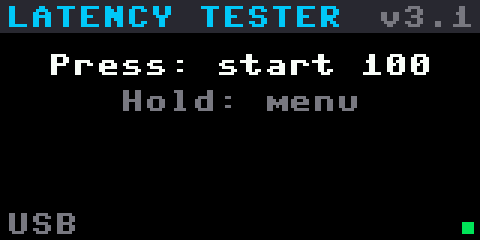 | 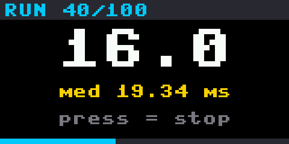 | 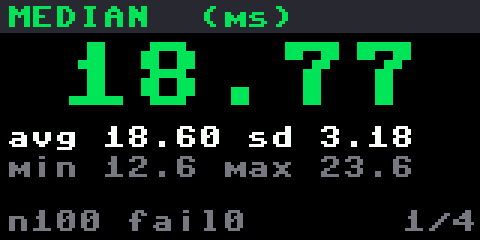 |
| 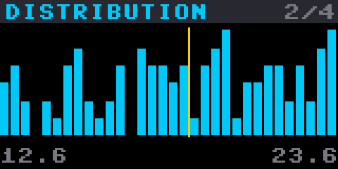 | 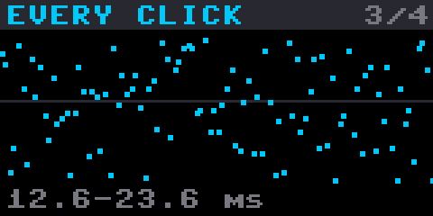 | 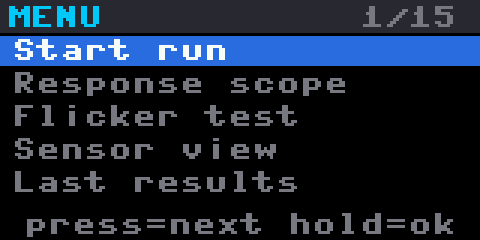 |

> **Status:** compiled for the RP2040 and tested end to end on a simulated
> board (see [Testing](#testing)). Not yet run on real hardware.

## Hardware

| Part | Notes |
|---|---|
| [Waveshare RP2040-LCD-0.96](https://www.waveshare.com/rp2040-lcd-0.96.htm) | Pico-compatible board with a built-in 160x80 colour screen |
| [Adafruit ALS-PT19](https://www.adafruit.com/product/2748) light sensor | Visible-light phototransistor breakout |
| One push button | Any momentary button, e.g. a 6x6 mm tactile switch |

Wiring:

| From | To |
|---|---|
| ALS-PT19 `+` | 3V3 (pin 36) |
| ALS-PT19 `-` | AGND (pin 33) |
| ALS-PT19 `OUT` | GP26 (pin 31) |
| Button | GP16 (pin 21) and GND (pin 23) - two diagonal legs on a 4-leg switch |

The screen is built in. Don't connect anything to GP8-GP12 or GP25 - the screen uses them.

## Case

The screen looks out through a window in the front, with the button beside it.
The light sensor looks out through a hole in the middle of the back, and the
loops on the sides take a strap to hold it against the monitor. About
56 x 27 x 16.5 mm (40 mm across the strap loops).

| Front | USB-C end | Back (sensor hole) | Button cap |
|---|---|---|---|
| 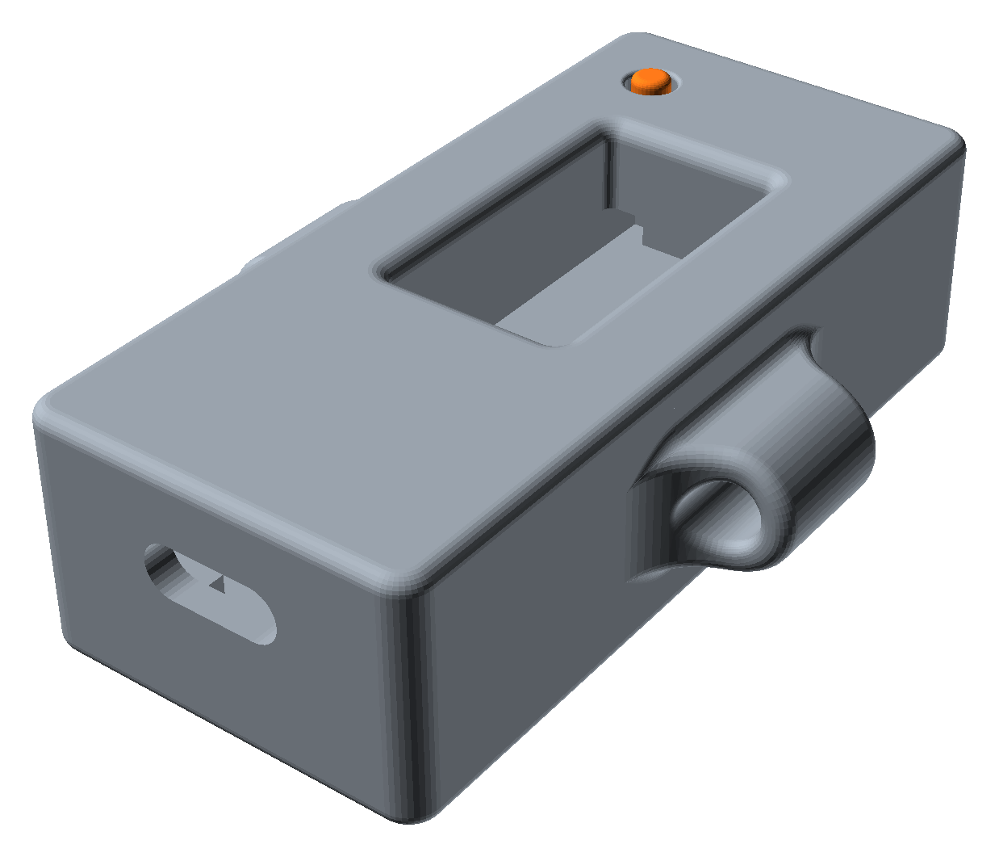 | 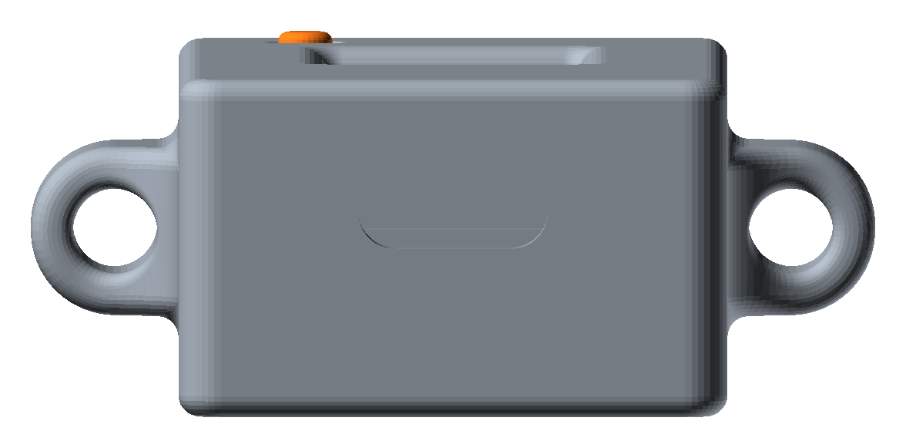 | 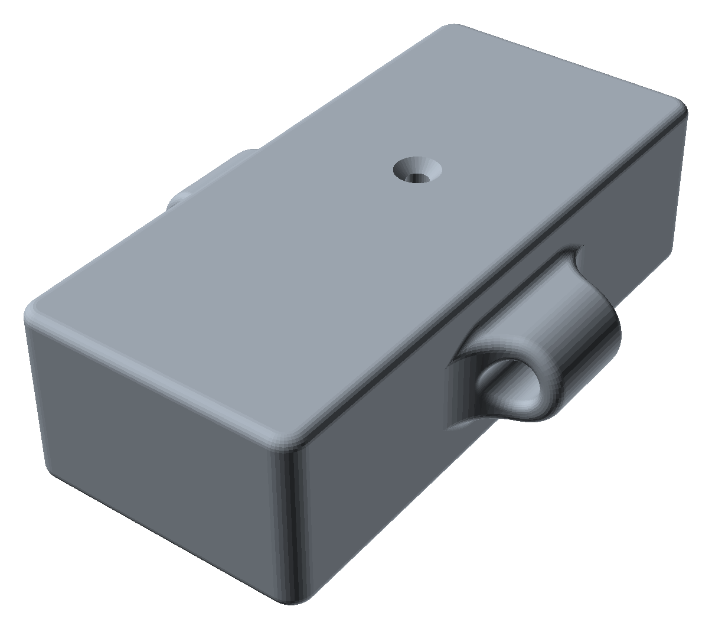 | 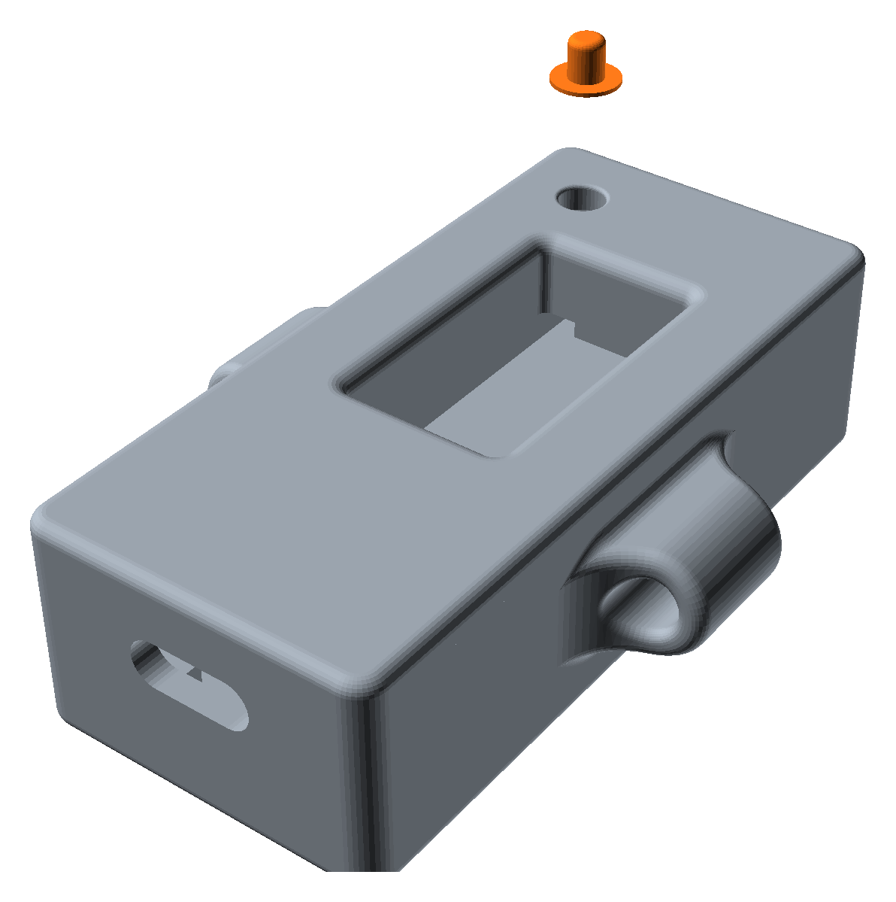 |

| File | |
|---|---|
| [`case/Pico_Latency_Tester_LCD.stl`](case/Pico_Latency_Tester_LCD.stl) | the whole model: case + button cap |
| [`case/case_only.stl`](case/case_only.stl) | just the case |
| [`case/button_cap_only.stl`](case/button_cap_only.stl) | just the button cap |

<details>
<summary>Earlier adjustable case (OpenSCAD)</summary>

[`case/parametric/`](case/parametric/) has the first case design: a two-part
push-fit box (56 x 26 x 13 mm) with every size a setting in
`latency_tester_v3_case.scad`. Kept for reference; the model above is the
current one.

| Assembled | Inside | Back |
|---|---|---|
| 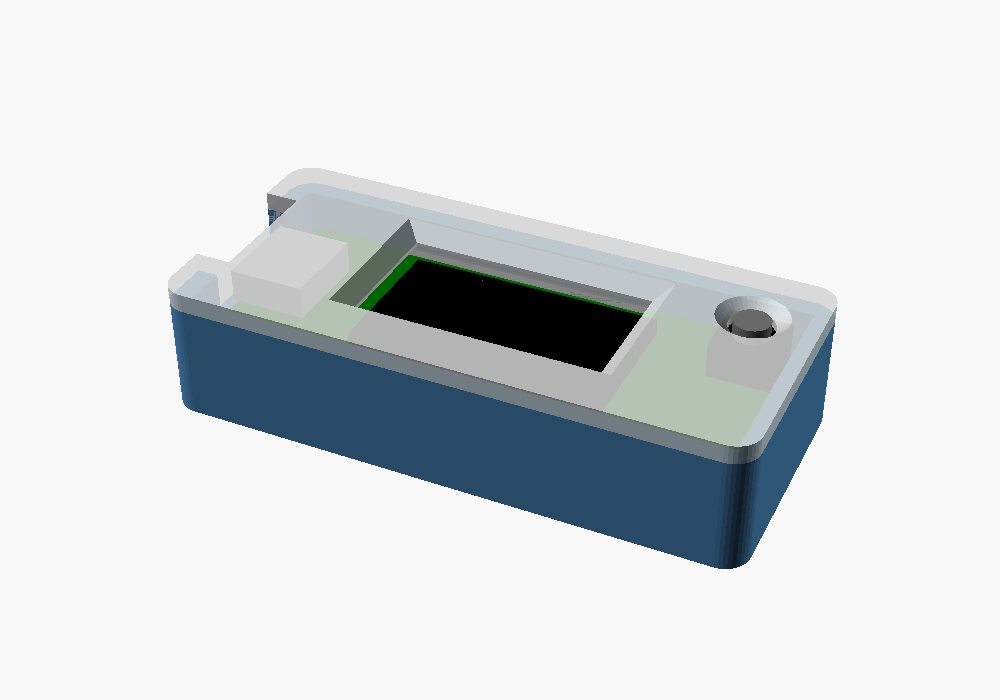 | 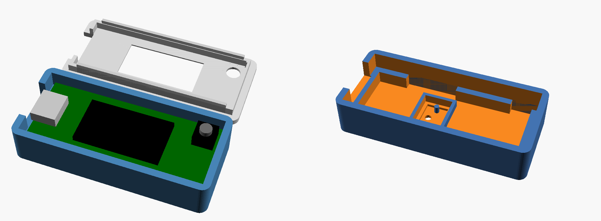 | 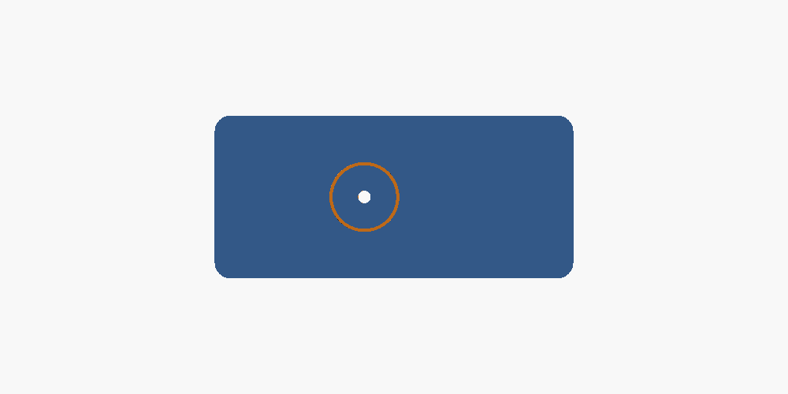 |

</details>

## Install

1. Hold **BOOT** and plug the board in. In Thonny: *Install MicroPython* ->
   **Raspberry Pi Pico / Pico H** (the board is an RP2040 with 2 MB flash).
2. Copy to the board with Thonny (*View -> Files*, right-click -> *Upload to /*):
   - `lib/` from this repo (the USB mouse library) -> `/lib`
   - **either** everything in `compiled/` (recommended - loads faster, uses less RAM)
   - **or** `main.py`, `lt_app.py`, `lt_hw.py`, `lt_display.py`
3. Unplug and plug it back in. The screen shows *LATENCY TESTER*; the dot in the
   bottom-right turns green once the PC has accepted it as a mouse.

If the picture is upside down, use *Flip screen* in the menu.

## Using it

**One button:** a short **press** starts, moves to the next item, or stops; **hold**
(0.7 s) opens the menu, selects, or goes back.

1. Open something on the PC that changes when you click: a game (muzzle flash),
   or [`target.html`](target.html) in a browser (press F for full screen).
2. Put the sensor flat on the screen where the change happens, and leave the
   mouse pointer over the target.
3. **Press** the button. During the countdown, switch to the target window.
4. The tester makes two warm-up clicks (plus one long calibration click on
   *Trigger: Auto*), then the timed clicks at random intervals. **Press** to stop early.
5. Results: **press** to page through median, histogram, every click and detail;
   **hold** to go back.

| Countdown | Detail | History |
|---|---|---|
| 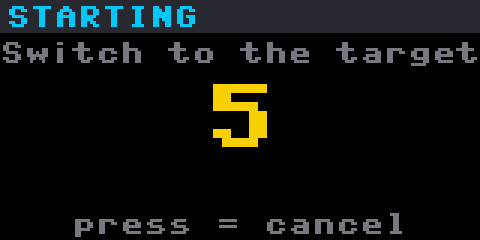 | 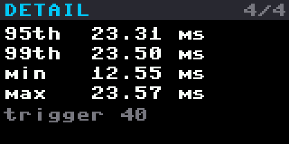 | 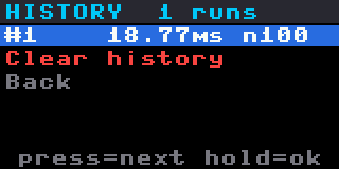 |

### Menu

| Item | What it does |
|---|---|
| Start run | Same as pressing the button on the home screen |
| Response scope | Countdown, then one click recorded at 200,000 samples/s: 50% point and 10->90% pixel response time, drawn as a graph |
| Flicker test | Countdown, then holds the mouse button down so the target turns white and records 190 ms of light: PWM backlight frequency and depth, "no flicker", or "too dark" if the sensor sees no light |
| Sensor view | Live sensor graph, redrawn continuously, to position the sensor. **Press** sends a click so you can see the jump; **hold** goes back |
| Last results | The last run again |
| History | Every run, newest first. **Press** moves down, **hold** opens a run (median, average, spread, 95th, fails). *Clear history* at the end of the list deletes them all (hold again to confirm) |
| Clicks | 20 / 50 / 100 / 200 / 500 |
| Countdown | 0 / 3 / 5 / 10 s |
| Detect | Either / Brighter / Darker - which way the screen changes |
| Trigger | **Small** (default, the most sensitive fixed trigger), Medium, Large, or **Auto** (calibrates from the screen with one long click) |
| Hold | How long each click is held: 40 / 60 / 100 / 200 ms |
| Gap | Random pause between clicks: Fast 150-300 / Normal 250-600 / Slow 500-1000 ms |
| Mouse | Left or right button |
| Flip screen | Rotates the display 180 degrees |

Settings are saved on the board. Each run is also saved as files you can read
with Thonny: `history.csv` (one summary line per run) and `last_run.csv`
(every click of the last run).

| Response scope | Flicker | Sensor view |
|---|---|---|
| 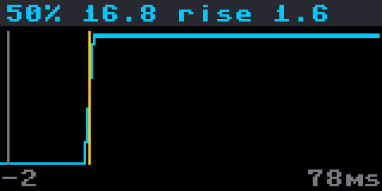 | 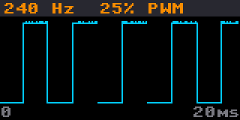 | 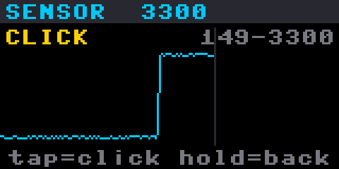 |
| 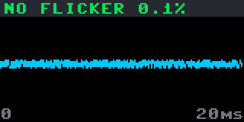 | 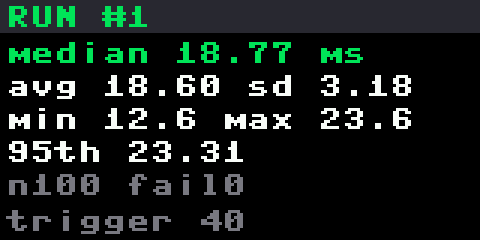 | 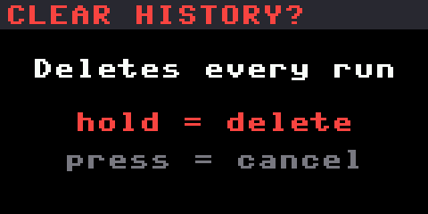 |

## How detection works

By default (**Trigger: Small**) a click counts as seen as soon as the sensor
moves 40 counts (of 4095) from its level just before the click - the earliest
reliable sign the screen has started to change. Medium and Large need a bigger
change, which suits noisy scenes.

With **Trigger: Auto**, the first click is held for 300 ms while the tester
records how far the sensor reading moves. The trigger is set to half that
change, in that direction - so on a black-to-white target it times to the 50%
point. If the change is too small to trust (a brief muzzle flash that's gone
by the time it looks), it falls back to a trigger just above the sensor noise,
in either direction.

Each click then:

1. averages the sensor for a baseline,
2. records the time and sends the mouse-down,
3. watches the sensor in a native-code loop (about 2 us resolution) until it
   has moved past the trigger for 3 samples in a row,
4. holds the button for the *Hold* time and releases it.

The hardware layer (`lt_hw.py`) is the same native code as the PC-app version:
the RP2040's 1 MHz timer and the ADC in free-running mode, read directly.

## Accuracy

As in the main project: the total is measured by one clock, so it's exact to a
few microseconds, plus 0-1 ms of USB polling delay per click (like a 1000 Hz
mouse). A browser target adds the browser's own delay - for the PC's best case,
use a native full-screen app or a game.

## Maintenance mode

Hold the button while plugging in (or press BOOTSEL): the program stops before
the USB mouse starts, and Thonny can connect. Thonny's Stop button also works
while it runs.

## Files

```
main.py          boot: maintenance mode, screen, USB mouse, then the app
lt_app.py        the app: one-button menus, runs, results, scope, flicker, history
lt_hw.py         hardware: viper timing loops, ADC, button, USB mouse, files
lt_display.py    ST7735S driver for the built-in 160x80 screen
target.html      a simple click target for the PC
lib/             micropython-lib USB device + HID mouse (MIT) - copy to /lib
case/            3D-printed case; parametric/ = earlier OpenSCAD design
images/          screenshots and case renders
compiled/        pre-compiled .mpy versions (build_mpy.sh)
tests/sim_board.py   runs lt_app.py on a simulated board, saves screenshots
```

## Testing

`lt_app.py` talks to the hardware only through `lt_hw`, so
`tests/sim_board.py` can run it unchanged in desktop Python against a fake
board:

- virtual time, and scripted button presses (short, long, and held)
- a model PC screen that turns white a random 12-24 ms after each mouse-down
  with a 2 ms pixel transition, a 240 Hz PWM backlight, or a sensor that sees
  nothing
- a framebuffer using MicroPython's own 8x8 font, so the screenshots on this
  page are pixel-for-pixel what the board draws

The script walks through 84 steps: a 100-click run and all results pages, the
menu and the default trigger, the response scope, the flicker test on a
flickering, a steady and a dark screen, sensor view with a click, history
(opening a run, clearing), flipping the
screen, and a run where the sensor sees nothing. The measured median matched
the model (17.8 ms true average + the 1 ms to reach the 50% point of the 2 ms
transition = 18.8 ms measured). All modules also compile with
`mpy-cross -march=armv6m`.

```sh
python tests/sim_board.py path/to/micropython/extmod/font_petme128_8x8.h out/
```

## Licence

MIT - see [LICENSE](LICENSE). The USB library in `lib/` is from
micropython-lib (MIT) - see [THIRD_PARTY_LICENSES.md](THIRD_PARTY_LICENSES.md).
